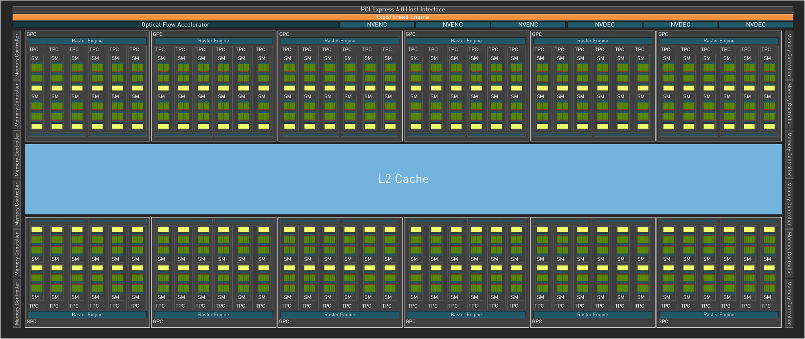
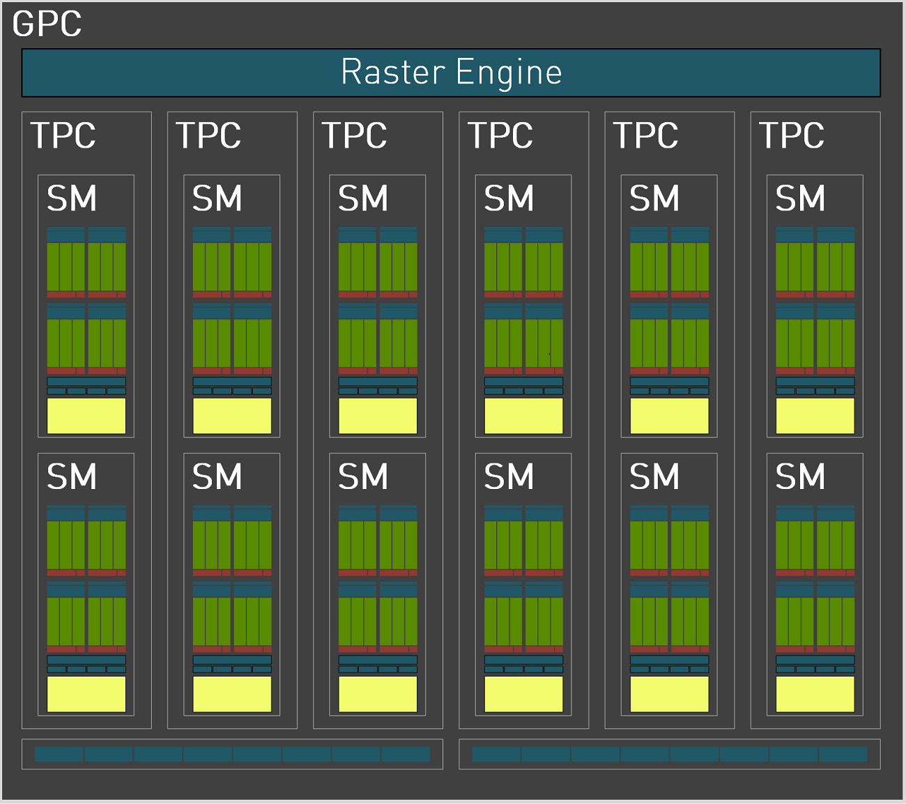
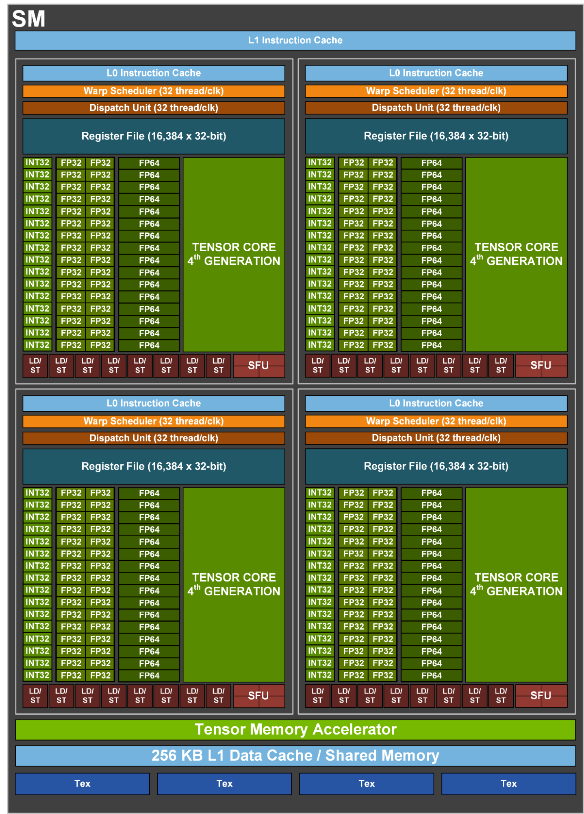
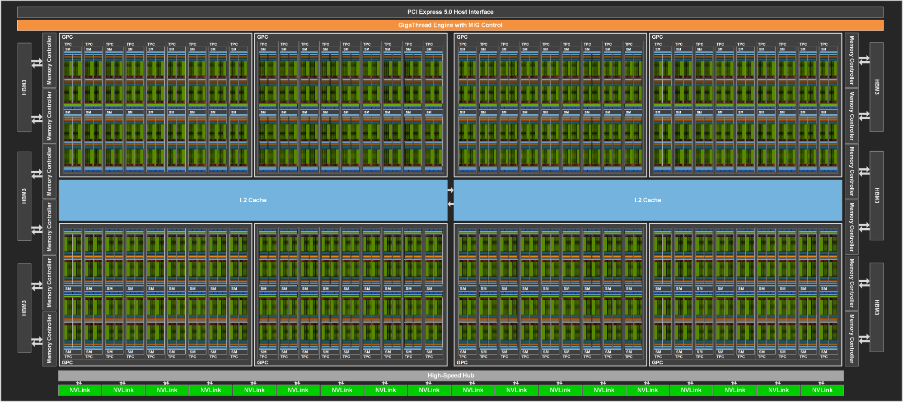
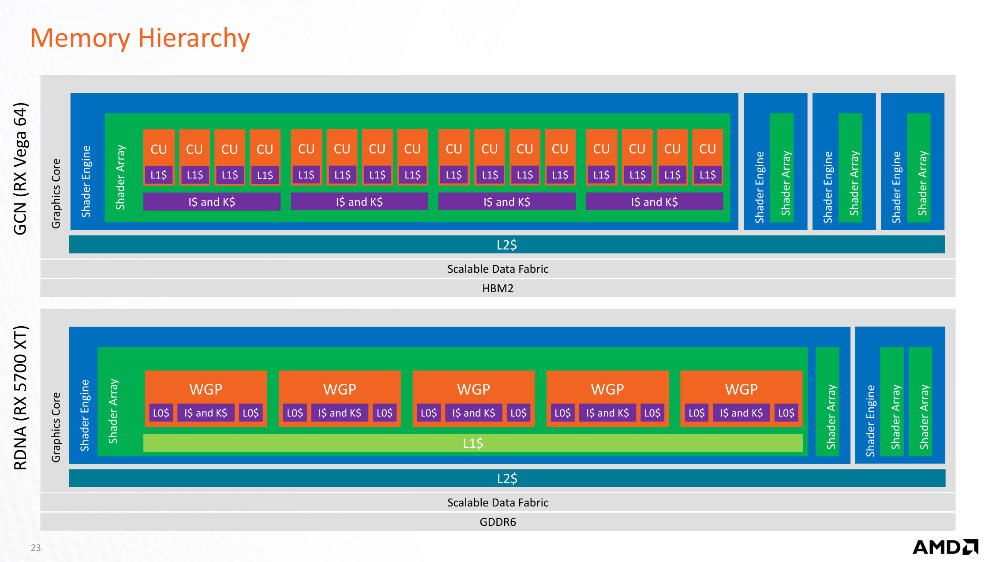

# GPU 架构图解

<p class="gpu-lede">一块 1920×1080 的屏幕有约 207 万个像素。按每秒 60 帧计算，GPU 每秒要算出 1.2 亿多个像素的颜色。这些像素运行的程序几乎相同，差别只在输入的数据。对这样的任务，单个像素算得多快并不要紧，要紧的是同一时间能处理多少个，以及数据能否及时送到。GPU 的结构，基本上都是围绕这两件事形成的。</p>

本篇先比较 CPU 和 GPU 如何分配芯片面积，然后跟着一条命令穿过整张显卡，逐层放大到 GPC、SM 和单条执行车道。硬件看清之后，再换到程序的角度，看 Grid、Block、Warp 和 Thread 怎样落到这些硬件上。最后讨论存储层次、图形与计算两条路径，并回答一个实际问题：什么任务适合交给 GPU。

<p class="gpu-note">这是 GPU 基础系列的第一篇。后两篇<a href="./ai-compute">AI 计算与性能分析</a>和<a href="./memory-interconnect">显存、搬移与互联</a>会把这里的结构换算成具体的时间和字节。</p>

<div class="gpu-legend" aria-label="图例">
  <span><i class="lc"></i>计算：可编程单元</span>
  <span><i class="lm"></i>存储：缓存、显存与内存</span>
  <span><i class="lf"></i>控制与固定功能硬件</span>
</div>

<p class="gpu-note">这套颜色只用于本页绘制的示意图。标有“官方原图”的图片来自厂商资料，保留各自原有的配色。</p>

## 同样的芯片面积，两种花法 {#why}

CPU 的目标是尽快跑完一条指令流。程序里的分支和依赖很难提前预料，所以每个核心都配了复杂的乱序调度和分支预测，让后面的指令尽量不必等前面的指令。这些逻辑确实让单条指令流跑得很快，同时也占去了大量面积。

GPU 面对的情况不同。几百万个像素执行同一段程序，彼此的先后顺序也不重要，再花面积去猜下一条指令就不太划算了。GPU 因此省掉这些复杂逻辑，把面积换成更多计算单元。单看一条执行路径，它比 CPU 核心慢；把所有路径加起来，吞吐却高得多。

<figure class="gpu-fig">
  <div class="gpu-scroll" tabindex="0"><FigCpuGpu /></div>
  <figcaption>示意图，面积比例并非实测。真实 GPU 的执行车道数以万计，这里每个小方块代表一组。</figcaption>
</figure>

这笔面积账决定了 GPU 的整体形态。下面跟着一条命令走一遍，看这些计算单元是怎样组织起来的。

## 一条命令如何穿过 GPU {#card}

GPU 可以看作一台独立的计算机：它有自己的命令处理器、缓存和显存。CPU 把绘制或计算命令写入命令缓冲区，再通知 GPU 有新命令，自己的工作到这里基本就结束了。GPU 的命令处理器经 PCIe 取回命令并解析；如果涉及大块数据，就交给复制引擎传入显存。

接下来，全局调度器把工作拆开，分给各个 GPC（Graphics Processing Cluster，图形处理集群）。真正执行着色器程序的是 GPC 里的 SM（Streaming Multiprocessor，流式多处理器）。图形任务还要多走两步：像素着色之前先经过 GPC 内的光栅引擎，输出时再经过 ROP（光栅操作单元）。

SM 一旦需要读写数据，请求就经片上互连按地址送往对应的存储分区。L2 缓存命中时直接返回，未命中时才由内存控制器访问显存。

<figure class="gpu-fig">
  <div class="gpu-scroll" tabindex="0"><FigSystem /></div>
  <figcaption>图中只画 4 组 GPC 和存储分区，实际数量因型号而异。</figcaption>
</figure>

对照这张图可以发现，命令走过的两段路差别很大。以 RTX 4090 为例，PCIe 4.0 x16 每方向 32 GB/s，显存通路却有 1008 GB/s，相差约 31.5 倍。计算和数据访问都留在显卡内部，正是为了少走那段窄路。这也是数据要尽量留在显存中的原因。

这些部件的数量相当可观。RTX 4090 的规模如下：

<div class="gpu-chain" aria-label="RTX 4090 的规模">
  <div><b>11</b><span>个 GPC（RTX 4090）</span></div>
  <div><b>64</b><span>个 TPC</span></div>
  <div><b>128</b><span>个 SM</span></div>
  <div><b>16,384</b><span>个 CUDA 核心</span></div>
</div>

最后一个数字容易让人误解。“CUDA 核心”没有独立的取指和调度逻辑，更接近下文所说的一条执行车道。真正相当于 CPU 核心的单位，更接近 SM。

### 对照官方框图：AD102 全芯片 {#ad102}

示意图省略了很多细节，现在可以和真实框图对照一下。RTX 4090 使用的 AD102 芯片如下图所示。图中是完整芯片，共 12 个 GPC、72 个 TPC、144 个 SM，RTX 4090 启用了其中 11 个 GPC、64 个 TPC 和 128 个 SM。

<figure class="gpu-fig">
  <div class="gpu-scroll" tabindex="0">
    
  </div>
  <figcaption><span class="gpu-tag">官方原图</span>AD102 GPU Full-Chip Block Diagram，出自 <a href="https://images.nvidia.com/aem-dam/Solutions/geforce/ada/nvidia-ada-gpu-architecture.pdf" target="_blank" rel="noopener">NVIDIA Ada GPU Architecture 白皮书</a> Figure 1。© 2023 NVIDIA Corporation。</figcaption>
</figure>

命令从顶部的 PCI Express 接口进入，经橙色的 GigaThread Engine（也就是全局调度器）分发到上下各 6 个 GPC，它们占据了芯片的大部分面积。中央的蓝色区域是 L2 缓存。官方图把它画成一整块，没有画出片上互连和分片。左右两侧共 12 个内存控制器，每个 32 位，合计 384 位显存接口。视频编解码引擎 NVENC 和 NVDEC 则独立于 GPC 之外。

### 再放大一层：GPC {#gpc}

打开一个 GPC，可以看到 1 个光栅引擎、6 个 TPC 和 16 个 ROP。每个 TPC 有 1 个 PolyMorph 引擎和 2 个 SM。前面的示意图为了简洁省略了 TPC 这一层，读规格表时要把它算进去：11 个 GPC 并不都有 6 个 TPC，所以 RTX 4090 启用的 TPC 是 64 个，SM 则正好是它的两倍。

<figure class="gpu-fig">
  <div class="gpu-scroll" tabindex="0">
    
  </div>
  <figcaption><span class="gpu-tag">官方原图</span>Ada GPC Block Diagram，出自同一白皮书 Figure 2。白皮书说明每个 ROP 分区有 8 个 ROP，对应图中底部的两条。© 2023 NVIDIA Corporation。</figcaption>
</figure>

## 一个 SM 内部：一条指令，多条车道 {#sm}

再放大一层就到了 SM。它省面积的办法是共用控制逻辑：一个 SM 分成 4 个处理块，每块由一个调度器和一个派发单元服务 32 条车道。调度器发出一条指令，32 条车道同时执行，就像一个人喊口令，一排人一起做动作。每条车道只保留运算器和自己的寄存器，同样的面积因此能放下更多运算器。下图画的相当于其中一个处理块。

<figure class="gpu-fig">
  <div class="gpu-scroll" tabindex="0"><FigSm /></div>
  <figcaption>为便于阅读，这里把一个处理块的 32 条车道简化成 8 条。L1 和共享内存按功能分开画，物理上是同一块可配置的存储，由 4 个处理块共用。虚线是整张图的关键：线程组等内存时让出执行机会，数据到了再回来。</figcaption>
</figure>

官方框图可以印证这个结构。下图是数据中心芯片 H100 的 SM，选它是因为标注详细。

<figure class="gpu-fig">
  <div class="gpu-scroll" tabindex="0">
    
  </div>
  <figcaption><span class="gpu-tag">官方原图</span>GH100 Streaming Multiprocessor，出自 <a href="https://developer.nvidia.com/blog/nvidia-hopper-architecture-in-depth/" target="_blank" rel="noopener">NVIDIA Hopper Architecture In-Depth</a> Figure 4。RTX 4090 的 SM 同样有 128 个 CUDA 核心和 256 KB 寄存器，但 L1 / 共享内存是 128 KB，FP64 单元也少得多。© NVIDIA Corporation。</figcaption>
</figure>

图中的 `Warp Scheduler` 选择下一个线程组，`Dispatch Unit` 派发指令，`Register File` 存放每条车道的寄存器，`LD/ST` 负责访问内存。每个处理块有 32 个 FP32 单元，4 块合计 128 个，这就是“128 个 CUDA 核心”的来历。图中的 `16,384 x 32-bit` 相当于每块 64 KB，4 块合计 256 KB。

只有运算器还不够，因为它们常常要等数据。H100 的显存空载延迟约 363 ns，接近饱和时超过 1 μs，折合数百甚至上千个周期。如果车道停下来等，省出来的面积就白花了。

这和洗衣服有些相似：把衣服放进洗衣机后，人不必站在旁边等它洗完，可以先去做别的事。SM 也是这样，它同时管理很多线程组（NVIDIA 称为 Warp）。某一组发出内存请求后，调度器在下一周期换另一组上来，数据到了再轮回这一组。切换的开销很低，因为每组线程的状态都留在寄存器文件中，不必保存和恢复。

<figure class="gpu-fig">
  <div class="gpu-scroll" tabindex="0"><FigWarp /></div>
  <figcaption>示意图：青色的“发指令”段首尾相接，执行单元从不闲置，尽管每个线程组大部分时间都在等内存。</figcaption>
</figure>

这个办法带来一个有意思的结果。单个线程组的大部分时间都在等内存，执行单元却一直有活干。GPU 靠切换线程组来容忍内存延迟，所以它的缓存可以比 CPU 的小，省下的面积又能换成运算器。

## 动手试试：分支为什么昂贵 {#lane}

共用一条指令也有代价，遇到 `if` 时就显现出来了。同一组车道里，有的线程要走 `if`，有的要走 `else`，可是调度器一次只能发一条指令。硬件的做法是让两条分支依次执行，并用掩码关闭不该执行的车道。被关闭的车道在这段时间什么也不做。这种执行模型叫 SIMT（Single Instruction, Multiple Threads，单指令多线程）。

下面这个实验展示的就是这一过程。点击第一行的输入值可以翻转正负，观察掩码和利用率的变化。

<SimtLab />

::: details 思考：8 条车道中 3 条走 if、5 条走 else，两段代码都要 10 个周期，利用率是多少？如果改成 7 条和 1 条呢？
两段依次执行，共占用 20 个周期，也就是 $8 \times 20 = 160$ 个车道周期。3 与 5 的情况下，有效工作为 $3 \times 10 + 5 \times 10 = 80$，利用率 50%。7 与 1 的情况下，有效工作同样是 80，利用率还是 50%。

只要两段等长，无论线程怎么分配，都只能发挥一半的能力。提高利用率的办法是减少分支发散，比如把走向相同的数据排在一起处理。如果 `else` 为空，掩码只关闭车道，不多占时间，这时利用率就等于走 `if` 的车道比例。
:::

## Grid、Block、Warp、Thread 如何落到硬件上 {#grid}

前面几节讲的是硬件有什么，接下来换一个角度，看程序如何被拆开。CUDA 用四个词描述这个过程，它们逐层包含：一个 Grid 由多个 Block 组成，一个 Block 由多个 Warp 组成，一个 Warp 有 32 个 Thread。

用一个例子来看。处理一张 1024×1024 的图像时，可以让每个像素对应一个 Thread。Block 取 16×16，也就是 256 个 Thread，正好分成 8 个 Warp。整张图像需要 64×64 个 Block，共 4096 个，它们合起来就是一个 Grid。

<figure class="gpu-fig">
  <div class="gpu-scroll" tabindex="0"><FigGrid /></div>
  <figcaption>1024×1024 的图像，每个像素一个 Thread：Block 取 16×16，Grid 由 64×64 个 Block 组成。</figcaption>
</figure>

**Thread** 是最小的执行单位，有自己的编号和寄存器。它通过 `threadIdx` 和 `blockIdx` 算出自己该处理哪份数据。

**Warp** 由编号连续的 32 个 Thread 组成，由硬件自动划分，上面的分支实验展示的就是一个 Warp 内部的情况，只是为了好读把 32 条车道简化成了 8 条。官方 SM 图中有 4 个 Warp 调度器，每个每周期处理 32 个线程，所以一个 SM 可以同时执行多个 Warp。正因为同一 Warp 共用指令，程序才要让同组线程的分支走向尽量一致，访问内存也尽量对齐和连续。

**Block** 是能够协作的一批 Thread，上限通常为 1024 个。Block 内部可以用共享内存和屏障同步，跨 Block 的数据就只能放在全局内存了。它的大小最好取 32 的倍数，否则最后一个 Warp 坐不满，多出的车道就闲置了。

**Grid** 是一次任务启动的全部 Block。不同 Block 的执行顺序没有保证，所以它们不应依赖彼此的先后。这项限制换来了很大的调度自由：硬件可以把 Block 分给任意空闲的 SM。

Block 之间的隔离也在逐渐松动。从 Hopper 开始，同一 GPC 内的多个 SM 可以组成**线程块簇**（最多 16 个 Block），簇内的 SM 能直接读写彼此的共享内存。

### 写成代码 {#kernel}

把这几个概念写成程序，就是下面这个向量加法 kernel：

```c
__global__ void vecAdd(const float *a, const float *b, float *c, int n) {
    // 用 Block 和 Thread 的编号算出自己负责的元素
    int i = blockIdx.x * blockDim.x + threadIdx.x;
    if (i < n) {
        c[i] = a[i] + b[i];
    }
}

// 主机端启动：<<<Block 数量, 每个 Block 的 Thread 数>>>
vecAdd<<<(n + 255) / 256, 256>>>(a, b, c, n);
```

函数里没有循环，每个 Thread 只处理一个元素，循环的工作由 Grid 完成。这里省略了分配显存和拷贝数据的步骤。

留意其中的 `if (i < n)`。假设 $n = 1000$，Block 数向上取整为 4，共 1024 个 Thread，多出的 24 个 Thread 算出的 `i` 越界。它们什么也不写，所在的车道被掩码关闭。前面实验里的分支代价，在这样一段最简单的程序里也会出现。

变量声明在哪里，也决定了它落到哪块硬件上：

| CUDA 内存类型 | 声明方式 | 硬件位置 | 共享范围 |
| --- | --- | --- | --- |
| 寄存器 | 局部变量 | 寄存器文件 | 单个 Thread |
| Local Memory | 寄存器不够时自动溢出 | 显存 | 单个 Thread |
| Shared Memory | `__shared__` | SM 片上存储 | 同一 Block |
| Global Memory | `__device__`、`cudaMalloc` | 显存 | 所有 Thread |
| Constant Memory | `__constant__` | 显存，有专用缓存 | 所有 Thread，只读 |

这张表里有一个名字容易误导人。`Local Memory` 虽然叫 local，实际却在显存上，访问很慢。寄存器不够时，编译器会自动把变量溢出到这里，这叫 Register Spilling，程序看起来没有任何变化，却可能明显变慢。

平时用 PyTorch 也能查到这些硬件信息：

```python
import torch

gpu = torch.cuda.get_device_properties(0)
print(gpu.name, gpu.multi_processor_count, gpu.total_memory)  # 型号、SM 数量、显存字节数
```

## 每跨过一道边界，都要付出更多代价 {#memory}

上面那张内存类型表已经暗示了一件事：数据放在哪里，比怎么计算更能决定速度。计算单元的速度通常不是瓶颈，瓶颈在于数据能否及时送到。

可以把存储层次想象成查资料的过程。手边的便笺（寄存器）只能写几行，但一抬眼就能看到；书桌（L1 和共享内存）能摊开几本书；书架（L2）要起身去拿，而且全办公室共用；楼下的资料库（显存）什么都有，每跑一趟却要花不少时间。写 GPU 程序时，很多优化都是在减少跨越下图中的虚线。

<figure class="gpu-fig">
  <div class="gpu-scroll" tabindex="0"><FigMemory /></div>
  <figcaption>方块宽度只表示容量递增的趋势，未按比例绘制。部分数据中心 GPU 用 HBM 堆叠显存，容量可达 80 GB 以上，带宽也更高。</figcaption>
</figure>

下表给出了各层的实际规模。从 SM 内部到 L2，再到显存，容量每次都大上两三个数量级，延迟也随之增加。

| 层级 | 容量 | 访问延迟 | 共享范围 |
| --- | --- | --- | --- |
| 寄存器 | 每 Thread 最多 255 个，每 SM 共 256 KB | 最低 | 单个 Thread |
| L1 / 共享内存 | RTX 4090 每 SM 128 KB；H100 每 SM 256 KB，其中最多 228 KB 可作共享内存 | 片上，SM 内部 | SM 或 Block |
| L2 | RTX 4090 72 MB，H100 50 MB，RTX PRO 6000 128 MiB | RTX PRO 6000 约 340~390 周期（120~135 ns） | 全芯片 |
| 显存 | 24~180 GB | H100 空载约 363 ns，接近饱和时 699~1433 ns | 全芯片 |

L2 的位置比较特殊。它分成多个分片，各管一段地址，经片上交叉互连与所有 SM 相连。多数情况下，它也是两个 SM 交换数据的唯一通道，所以 SM 之间的协作都要付这一趟的代价。具体是多少，第三篇的[SM 之间：只能经由 L2](./memory-interconnect#handoff)会算出来。

## 两条路径，共用一批计算单元 {#pipeline}

讲到这里，我们一直把 SM 当作通用的计算单元，这其实是 GPU 演进的结果。早期 GPU 为顶点和像素分别设置专用硬件，后来它们都统一运行在 SM 上，同一张卡才既能渲染游戏，也能训练神经网络。两者的区别只在于是否经过固定功能阶段。

<figure class="gpu-fig">
  <div class="gpu-scroll" tabindex="0"><FigPipeline /></div>
  <figcaption>简化后的光栅化管线，省略了曲面细分等可选阶段。箭头上方标注的是在阶段之间传递的数据。</figcaption>
</figure>

出现新的工作负载时，厂商通常保留通用结构，再为最耗时的部分增加专用硬件。光线追踪需要遍历加速结构（BVH）并计算光线与三角形求交，于是计算单元内部有了光线追踪单元；神经网络的主要工作是矩阵乘法，于是又有了矩阵单元（NVIDIA 称为 Tensor Core）。视频压缩和解压由独立的编解码引擎完成，不占用着色器。

芯片之外的改动也是同样的思路。HBM 堆叠显存放在封装内，紧贴芯片，用极宽的总线提供更高的带宽；NVLink 这样的多卡互连绕过 PCIe，让多块 GPU 之间高速传输数据。

### 官方框图对比：面向计算的 GH100 {#gh100}

用途如何影响设计，把两张官方框图放在一起看就很清楚。GH100 同样由 GPC、L2 和内存控制器组成，但图上没有了光栅引擎和视频引擎，多了 HBM3 和 NVLink。按 NVIDIA 公布的数字，H100 SXM5 的显存带宽超过 3 TB/s，L2 缓存为 50 MB。

<figure class="gpu-fig">
  <div class="gpu-scroll" tabindex="0">
    
  </div>
  <figcaption><span class="gpu-tag">官方原图</span>GH100 Full GPU with 144 SMs，出自 <a href="https://developer.nvidia.com/blog/nvidia-hopper-architecture-in-depth/" target="_blank" rel="noopener">NVIDIA Hopper Architecture In-Depth</a> Figure 3。© NVIDIA Corporation。</figcaption>
</figure>

## 各厂商术语对照 {#terms}

其他厂商的 GPU 结构相似，只是名称不同。本页使用 NVIDIA 的叫法，读其他资料时可以按下表换算，不过各家的单元划分并非严格一一对应。

| 概念 | NVIDIA | AMD | Intel |
| --- | --- | --- | --- |
| 大型分区 | GPC | Shader Engine | Render Slice |
| 计算单元 | SM | CU（2 个组成 WGP） | Xe-core |
| 执行车道 | CUDA 核心 | 流处理器 | XVE 内的 SIMD 通道 |
| 一次任务的全部线程 | Grid | NDRange | ND-range |
| 可协作的一批线程 | Block | Work-group | Work-group |
| 同行的线程组 | Warp（32 线程） | Wavefront（32 或 64） | SIMD 线程（8、16 或 32） |
| 单个线程 | Thread | Work-item | Work-item |
| 组内共享存储 | Shared Memory | LDS | SLM |
| 原生计算接口 | CUDA | ROCm / HIP | oneAPI / SYCL |

名称相同的部件也未必等价。AMD 的官方图说明了这一点：下图上半部分是 GCN 架构，下半部分是 RDNA 架构。在 RDNA 中，两个 CU 合并成一个 WGP，缓存层级也变成 L0、L1、L2 三级，所以不同厂商的“L1”不能直接比较。

<figure class="gpu-fig">
  <div class="gpu-scroll" tabindex="0">
    
  </div>
  <figcaption><span class="gpu-tag">官方原图</span>Memory Hierarchy，出自 AMD GPUOpen 的 <a href="https://gpuopen.com/download/RDNA_Architecture_public.pdf" target="_blank" rel="noopener">RDNA Architecture 演示文稿</a>第 23 页。© Advanced Micro Devices, Inc.</figcaption>
</figure>

## 什么任务适合 GPU {#fit}

回头看前面各节，判断一个任务是否适合 GPU，大致可以问四个问题，每个问题都对应一项硬件特点。

第一，任务能否拆成海量同类的小任务？单条车道并不快，只能串行的逻辑放到 GPU 上反而吃亏。第二，这些小任务的执行路径是否基本一致？路径差异大时，掩码会让大量车道闲置。第三，内存访问是否连续、规整？GPU 的缓存较小，靠带宽取胜，指针追逐和随机访问都很难发挥它的优势。第四，数据能否长期留在显存？PCIe 带宽远低于显存，频繁往返 CPU 会让时间花在路上。

这四个问题目前只给出了定性的判断。要知道一项任务到底卡在算力还是带宽，加一倍硬件能换来多少速度，还需要把它们变成数字。下一篇[AI 计算与性能分析](./ai-compute)就以矩阵乘法为例，做这件事。

<p class="gpu-note">RTX 4090 的规格来自 NVIDIA Ada 白皮书的附录 A：384-bit GDDR6X、21 Gbps、24 GB 显存、1008 GB/s 带宽。本页自绘的结构图为教学简化，不同代际和厂商的细节有所不同。</p>

<p class="gpu-note">官方原图的版权归 NVIDIA 和 AMD 所有，这里仅用于学习说明，并已标明出处。</p>
